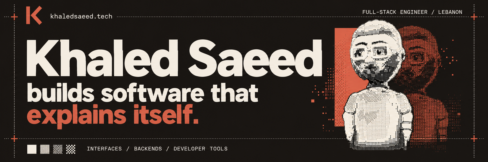

[](https://khaledsaeed.tech)

<p align="center">
  <a href="https://khaledsaeed.tech"></a>
</p>

# khaledsaeed.tech

The personal site of Khaled Saeed ([@KhaledSaeed18](https://github.com/KhaledSaeed18)), a full-stack engineer in Lebanon. It holds my work, my experience, my writing and a way to reach me, and it is built the way I like software to be: clear about what it is doing, with nothing left for the next person to guess.

[Work](https://khaledsaeed.tech/work) · [Experience](https://khaledsaeed.tech/experience) · [About](https://khaledsaeed.tech/about) · [Writing](https://khaledsaeed.tech/writing) · [Contact](https://khaledsaeed.tech/contact)

## The idea

The whole site is a 1-bit print run. Paper is cut straight, so every corner is square. Every page sits in one frame with dotted rails at its edges, section rules run the full width of the screen and cross the rails at registration marks, and every tone is a 4x4 Bayer dither. Projects are printed on coloured card stock, each with its own dithered 3D object, and the hero is a live self-portrait raymarched in a single shader.

Underneath the print is a working press: the site can be proofed, magnified, separated into its plates, marked up, printed and read offline.

## What's inside

| Page                                                 | What it is                                                                                                                             |
| ---------------------------------------------------- | -------------------------------------------------------------------------------------------------------------------------------------- |
| [`/`](https://khaledsaeed.tech)                      | The live portrait, selected work on the press, the experience tape, the stack as a chip datasheet, credentials, writing and a postcard |
| [`/work`](https://khaledsaeed.tech/work)             | The job book: a filterable ledger of every project, and a case study for each at `/work/[slug]`                                        |
| [`/experience`](https://khaledsaeed.tech/experience) | Client work since Sep 2024, chapter by chapter                                                                                         |
| [`/about`](https://khaledsaeed.tech/about)           | Bio and specifications, with education and certifications on their own sheets                                                          |
| [`/writing`](https://khaledsaeed.tech/writing)       | The back issues: articles from DEV, set in the site's type, with canonical links back to DEV                                           |
| [`/contact`](https://khaledsaeed.tech/contact)       | The reply postcard, a profile directory and Beirut time                                                                                |

For machines: [`/llms.txt`](https://khaledsaeed.tech/llms.txt), [`/writing/rss.xml`](https://khaledsaeed.tech/writing/rss.xml), [`/sitemap.xml`](https://khaledsaeed.tech/sitemap.xml) and a vCard at [`/khaled-saeed.vcf`](https://khaledsaeed.tech/khaled-saeed.vcf).

## Things to find

Most of the site's tools are one key away. Press `?` on any page for the full legend.

| Try                       | What happens                                                                                                                                 |
| ------------------------- | -------------------------------------------------------------------------------------------------------------------------------------------- |
| `⌘K` or `/`               | The job ticket: a command palette over every page, project, article and action                                                               |
| Right-click               | The mark-up slip: quote a selection, link to the exact passage, stamp the proof, set a quote card, and the rest of the tools                 |
| Select text, right-click  | **Quote cards**: the passage set as a shareable image, checked server-side against the page so nobody can put words in my mouth              |
| Hold `⌥` (or press `l`)   | **The printer's loupe**: magnify the live page down to the dither dots, with a readout of the ink and type under it                          |
| `x`                       | **Plate separation**: the page pulled apart into paper, rules, teal, terracotta and ink, fanned out in 3D (the portrait is split dot by dot) |
| `v` on a case study       | **Revision marks**: the case study as a marked-up proof of its own git history, stepping back through every printing                         |
| `p`                       | **Proof mode**: the 12-column grid, frame numbers and live type metrics over the page                                                        |
| Footer: print my receipt  | **The visit receipt**: a thermal printout of your visit, with pages, time, paper scrolled and a working barcode. Nothing leaves your browser |
| `⌘P`                      | A one-page A4 résumé with crop marks, or a one-sheet case study on a project page                                                            |
| Go offline                | **The offline press**: pages you read, and the main pages, keep working without a connection                                                 |
| A page that doesn't exist | **The misprint**: drag the terracotta plate back into register                                                                               |
| Open DevTools             | The console has a colophon and a puzzle                                                                                                      |
| Visit late at night       | Between 01:00 and 07:00 Beirut time the portrait dozes; a click wakes it                                                                     |

There are one or two others. They are left for you to find.

## How it's built

- **Next.js 16.3** (App Router, React view transitions), **React 19**, **TypeScript**, **Tailwind CSS 4**, a few **shadcn/ui** primitives with their corners filed off, and a custom set of two-plate animated glyphs instead of an icon library.
- **The portrait** (`components/dither-character.tsx`) is a signed distance field raymarched in one WebGL2 fragment shader, dithered on the GPU, with adaptive quality tiers and a static fallback.
- **The dither system** (`app/dither.css`) holds the 17 Bayer mask levels, the object sprites and the site's whole motion vocabulary: fades, short rises and nothing else, each with a reduced-motion fallback.
- **Project objects** are 16-frame, 1-bit sprites rendered from signed distance fields in a dev-only studio.
- **Live data** is fetched at build time and revalidated daily: articles from the DEV API and star counts from GitHub. Case study revisions come from this repository's own git history.
- **Social images** for every page and every quote card are drawn by `next/og` in the same type and colours.
- **No analytics and no cookies.** The visit receipt, the stamps and the rest keep what they know in your browser.

The design rules (square corners, the frame, rails and rules, stacked headings, simple motion) are written down in [`AGENTS.md`](AGENTS.md).

## Running it locally

Needs Node.js 20.9 or newer and pnpm.

```bash
pnpm install
pnpm dev
```

Then open [localhost:3000](http://localhost:3000).

| Script           | Does                                                                                      |
| ---------------- | ----------------------------------------------------------------------------------------- |
| `pnpm dev`       | Starts the dev server                                                                     |
| `pnpm build`     | Records case study revisions from git history, then builds for production                 |
| `pnpm start`     | Serves the production build (the service worker only runs here, not in dev)               |
| `pnpm lint`      | Runs ESLint                                                                               |
| `pnpm typecheck` | Runs the TypeScript compiler without emitting                                             |
| `pnpm format`    | Formats with Prettier                                                                     |
| `pnpm revisions` | Rewrites `lib/content/revisions.json` from git history (needs a full, not shallow, clone) |

Set `GITHUB_TOKEN` for a higher GitHub rate limit; without it, star counts are simply left out.

Dev-only query params on the home page: `?shade` (no dither), `?zoom` (head close-up), `?still` (skip the print-in), `?fallback` (the no-WebGL image), `?q=0|1|2` (force a quality tier) and `?sleep` (the night portrait).

## Updating the content

Everything on the site is single-sourced in `lib/content`, and the public identity (name, username, links) in `lib/site.ts`. Copy follows the house rules: sentence case, no em dashes, no emoji.

**Adding a project**

1. Add an entry to `projects` in `lib/content/projects.ts`. Set `featured: true` to put it on the home press (keep six featured) and `updatedAt` when a case study changes significantly, so sitemap dates describe the content.
2. Pick an existing `object`, or add one: a signed distance function in `components/studio/object-studio.tsx`, plus its name in `ObjectKind`, `lib/content/objects.ts` and `scripts/render-objects.mjs`.
3. With `pnpm dev` running, `node scripts/render-objects.mjs <object>` writes its sprite to `public/objects/` and its social card art to `public/og/<slug>.png`.
4. Everything else (the ledger, case study, sitemap, structured data, `llms.txt`, counts) follows from the entry.

**Revising a case study**: edit its copy and commit. The next local `pnpm build` (or `pnpm revisions`) records the new printing in `lib/content/revisions.json`; commit that file too, since Vercel builds from a shallow clone and keeps the committed history.

**Profile changes**: update `profileUpdatedAt` in `lib/site.ts` when the home or about profile changes significantly.

## Production

Deployed on Vercel. Security headers are set for every route in `next.config.ts`, the footer's edition is the build commit, and `pnpm audit --prod` should stay clean (patched transitive versions are pinned under `overrides` in `pnpm-workspace.yaml`).

## Contributing

Bug fixes, accessibility improvements, broken links and typos are welcome; read [CONTRIBUTING.md](CONTRIBUTING.md) first, and please open a discussion before proposing new features, redesigns or changes to personal content. Use the [issue tracker](https://github.com/KhaledSaeed18/khaledsaeed.tech/issues/new/choose) for problems with the site, follow the [Code of Conduct](CODE_OF_CONDUCT.md), and report vulnerabilities privately as described in [SECURITY.md](SECURITY.md).

For work, use the [contact page](https://khaledsaeed.tech/contact).

## License and reuse

The original code is [MIT licensed](LICENSE). My personal content and assets (writing, biography, résumé, portrait and branding) are not covered by that license; see [CONTENT_LICENSE.md](CONTENT_LICENSE.md). If you build your own site from this code, replace them with your own.
